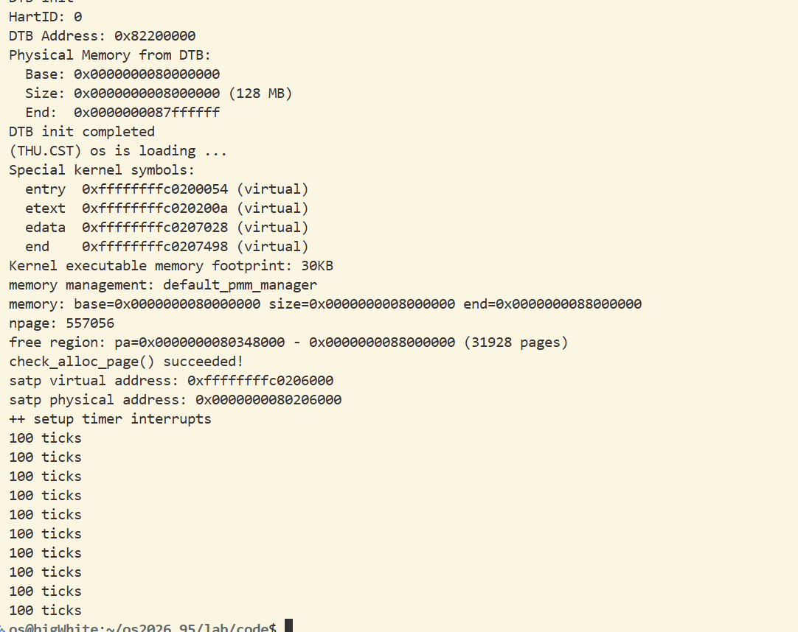
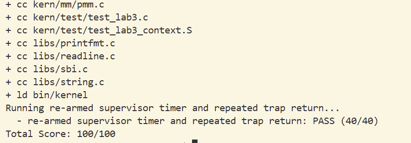

# 操作系统实验报告

## 实验基本信息

| 项目       | 内容                                 |
| -------- | ---------------------------------- |
| **实验名称** | Lab3 : \[断,都可以断]                  |
| **小组成员** | 2413330-张子馨、2410691-刘思岑、2411191-王可 |
| **完成日期** | 2026-10-29                         |

### 小组分工

| 成员          | 负责的模块                |
| ----------- | -------------------- |
| 2413330-张子馨 | 功能模块二 |
| 2410691-刘思岑 | 功能模块一 |
| 2411191-王可  | 无      |

2413330-张子馨负责功能模块二实现部分，参与撰写AI协作开发经验， 2410691-刘思岑负责撰写功能模块一实现部分，参与撰写实验总结与收获和AI协作开发经验，2411191-王可负责撰写报告其他所有部分，参与撰写AI协作开发经验。

***

## 一、实验目的

本实验的主要目的是：

1. 理解页表的建立和使用方法
2. 理解物理内存的管理方法
3. 理解页面分配算法

***

## 二、实验环境

| 成员          | AI 编程工具          | 底层模型                              | 备注                    |
| ----------- | ---------------- | --------------------------------- | --------------------- |
| 2413330-张子馨 | Cline（VS Code插件） | DeepSeek-V4-Flash和DeepSeek-V4-pro | 勾选了计划和执行时使用不同的模型      |
| 2410691-刘思岑 | Codex(VS Code插件) | ChatGPT-6 Sol                     | 无                     |
| 2411191-王可  | Codex（终端Agent）   | GPT-6.1-Sol                       | 使用WSL环境运行Codex终端Agent |

***

## 三、实验整体逻辑分析

### 2.1 本章节的逻辑主线

- 本章围绕RISC-V的中断与异常处理机制展开，核心是建立从程序被打断到恢复执行的完整流程。实验以已有的代码和TrapFrame结构为基础，补全上下文恢复、汇编入口与 C 语言处理函数的衔接，再实现时钟中断、断点和非法指令异常的分类处理。
- 实验解决内核如何在硬件事件或程序异常发生时接管执行，并在处理后正确返回的问题。一方面，需要保存和恢复寄存器状态，保证处理过程不破坏原有执行现场；另一方面，需要根据事件类型执行相应操作，如设置下一次时钟事件、累计时钟次数，以及调整异常返回地址，避免重复触发同一异常，使内核具备持续响应事件并恢复执行的能力。

### 2.2 功能的逐步实现

1. 首先，依据已有的SAVE_ALL和struct trapframe布局补全RESTORE_ALL，恢复通用寄存器、sstatus和sepc，特别注意原栈指针的恢复方式。上下文恢复必须与保存方式一致，才能避免执行现场被破坏，为后续Trap处理提供基础。

2. 接着，补全 __alltraps，按调用约定将当前TrapFrame地址传给已有的trap，再经trap_dispatch分类分发。处理结束后进入 __trapret，恢复上下文并执行sret，形成从汇编入口到C语言处理、再返回原执行流的完整链路。

3. 然后，补充exception_handler，识别断点和非法指令异常，输出相应信息，并按指令长度调整epc，避免返回后重复触发异常。这依赖前面的现场保存和返回机制，也为检查返回地址与寄存器恢复提供验证场景。

4. 同时，补充interrupt_handler的时钟处理，设置下一次事件、累计ticks并定期输出，使中断能够持续触发。它与异常处理共同依赖公共Trap框架，二者没有必须先后的关系。

5. 最后，结合已有的idt_init、clock_init和intr_enable检查初始化衔接，并利用测试验证寄存器恢复、异常返回和持续时钟响应。这一步用于检查各模块能否协同工作。

---

## 四、实验内容与实现


### 功能模块一：Trap 上下文恢复与 Trap 入口（`kern/trap/trapentry.S`）

**最终功能：** Trap 发生时，由已有的 `SAVE_ALL` 在栈上形成与 `struct trapframe` 一致的现场；`__alltraps` 将该帧的地址作为第一个参数传给 C 语言 `trap(struct trapframe *tf)`；`trap()` 返回后，`__trapret` 调用 `RESTORE_ALL`，恢复被打断程序的通用寄存器、`sstatus`、`sepc` 和原栈指针，最后通过 `sret` 回到正确的执行位置。该模块提供完整的“保存现场 → 调用 C 处理 → 恢复现场 → Trap 返回”底层闭环，具体中断和异常的分类处理由模块二负责。


#### 任务一：实现 `RESTORE_ALL`，恢复 Trap frame 中的寄存器与返回状态

##### 功能与接口
功能：
    从 Trap frame（异常现场保存区）中恢复发生异常前的寄存器状态，为返回原程序做准备。

接口表：

| 项目 | 内容 |
|---|---|
| 实现位置 | `kern/trap/trapentry.S` |
| 实现对象 | `RESTORE_ALL` 汇编宏 |
| 输入 | `sp` 指向的 Trap frame |
| 布局依据 | `trap.h` 中的 `struct trapframe`，以及已有的 `SAVE_ALL` |
| 核心功能 | 恢复通用寄存器、`sstatus` 和 `sepc` |
| 特别注意 | `x2(sp)` 必须最后恢复，否则会失去 Trap frame 的寻址基址 |
| 完成后 | 由 `__trapret` 中的 `sret` 返回 |


##### spec

**Spec：** 前置条件是 `SAVE_ALL` 已产生完整 Trap frame，且 `sp` 指向帧首；后置条件是处理函数可能修改的 `status`、`epc` 已写回对应 CSR，所有可写通用寄存器恢复为帧中值，`sp` 恢复为 Trap 前的值。恢复其他寄存器期间不能提前改变作为帧基址的 `sp`；即从已经保存好的 Trap frame 中恢复现场，保证程序能从正确位置继续执行；恢复 sp 必须放在最后。

**最终 Prompt：**


[PROMPT]

任务：完成 Lab3 功能模块一，使 Trap 处理形成“保存现场 → 调用 C 处理函数
→ 恢复现场 → 返回原执行流”的完整流程。
修改位置：只修改 kern/trap/trapentry.S 中两处标有
“#lab3 function1 YOUR CODE”的位置，分别补全 RESTORE_ALL 宏和
__alltraps 入口。保留 lab3 function1 注释，将 YOUR CODE 改为负责人
学号 2410691。不要修改其他文件或无关代码。

[RELY]


实现时可以依赖项目中已有的：

1. SAVE_ALL：已将 Trap 现场保存到当前 sp 指向的 Trap frame。
   其中原来的 x2(sp) 经 sscratch 保存到帧的第 2 槽。
2. kern/trap/trap.h 中的 struct trapframe：
   第 0～31 槽是通用寄存器；第 32～35 槽依次是
   status、epc、badvaddr、cause。
3. trap(struct trapframe *tf)：已有的 C 语言 Trap 处理接口。
4. __trapret：已有的返回入口，会执行 RESTORE_ALL 和 sret。
5. riscv.h 中的 LOAD、REGBYTES 等宏，以及 RISC-V 调用约定：
   第一个函数参数通过 a0 传递。

[GUARANTEE]


必须交付以下两处实现：

1. RESTORE_ALL 汇编宏：从当前 Trap frame 恢复执行现场。
2. __alltraps 中 SAVE_ALL 之后的代码：把 Trap frame 传给 trap()，
   并在 trap() 返回后衔接 __trapret。

不得修改 SAVE_ALL、struct trapframe、trap() 的函数签名，以及现有的
__trapret 和 sret。

[SPECIFICATION]


1. RESTORE_ALL

- 开始执行时，sp 指向 SAVE_ALL 建立的 Trap frame。
- 按实际帧布局恢复 sstatus、sepc 和可写通用寄存器。
- x0 是恒为零的寄存器，无需恢复；badvaddr 和 cause 不需要写回 CSR。
- 第 2 槽保存的是 Trap 发生前的 sp。必须等所有以当前 sp 为基址的
  帧数据读取完成后，最后恢复 x2(sp)。
- 执行结束时，寄存器和返回位置应与 Trap frame 中记录的状态一致，
  随后可由 sret 返回。

2. __alltraps

- SAVE_ALL 执行后，当前 sp 是完整 Trap frame 的首地址。
- 按 RISC-V 调用约定，把这个地址作为 struct trapframe * 参数传给
  trap(struct trapframe *tf)。
- trap() 返回后，sp 仍须指向同一个 Trap frame，使控制流能够进入
  __trapret 并正确恢复现场。
- 不另行假设 Trap frame 布局，也不改动已保存的现场。
##### 实现过程与关键代码

实现先写回 `sstatus` 和 `sepc`，再加载其余通用寄存器，最后执行 `LOAD x2, 2*REGBYTES(sp)`。这样 `sp` 在全部读取 Trap frame 的过程中始终是帧基址。`LOAD` 和 `REGBYTES` 沿用项目的 `riscv.h` 宏定义。

##### 遇到的问题、修复及验证

已在实现时避免一个关键顺序错误：如果提前恢复 `x2`，后续加载会以 Trap 前的栈指针寻址，读错 Trap frame。当前已做静态核对；运行时寄存器恢复、断点返回等结果需在可用的 RISC-V 工具链与 QEMU 环境中验证，尚未记录为通过。

#### 任务二：实现 `__alltraps`，向 C 语言 `trap()` 传递 Trap frame

##### 功能与接口

功能：

Trap 发生后，`__alltraps` 保存现场，并把 Trap frame 交给 C 语言的 `trap()` 处理。处理结束后，进入现场恢复和返回流程。

接口表：

| 项目 | 内容 |
|---|---|
| 实现位置 | `kern/trap/trapentry.S` |
| 实现对象 | `__alltraps` 汇编入口 |
| 输入 | Trap 发生时的处理器状态 |
| 已有依赖 | `SAVE_ALL` 将现场保存为 Trap frame，此时 `sp` 指向帧首 |
| 调用接口 | 将 `sp` 放入参数寄存器 `a0`，调用 `trap(struct trapframe *tf)` |
| 返回要求 | `trap()` 返回后，`sp` 仍指向该 Trap frame |
| 后续流程 | 进入 `__trapret`，由 `RESTORE_ALL` 恢复现场，再执行 `sret` 返回 |


##### Spec：
**Spec：** 前置条件是处理器因 Trap 跳转到 `__alltraps`；后置条件是 `trap()` 收到有效、完整的 Trap frame 指针，返回后继续进入 `__trapret`。调用前后必须维持帧基址和 RISC-V ABI 对栈的要求，不得破坏待恢复的帧内容。

**最终 Prompt：**
[PROMPT]
任务：补全 Trap 汇编入口与 C 语言处理函数之间的调用。

只修改 kern/trap/trapentry.S 中 __alltraps 下方标有
“#lab3 function1 YOUR CODE”的位置。先阅读该文件和 kern/trap/trap.h，
依据现有代码完成传参和调用，不修改其他位置。保留 lab3 function1
注释，并将 YOUR CODE 改为负责人学号 2410691。

[RELY]
可以依赖以下已有内容：

1. SAVE_ALL 已在 __alltraps 中执行，并在当前栈上建立完整的 Trap frame。
   执行后，sp 指向该帧的首地址。
2. kern/trap/trap.h 定义了 struct trapframe，并声明了
   void trap(struct trapframe *tf)。
3. RISC-V 调用约定使用 a0 传递第一个函数参数。
4. __trapret 已存在，其后续流程是 RESTORE_ALL 和 sret。

[GUARANTEE]
必须补全 __alltraps 中 SAVE_ALL 之后的代码，使其完成两件事：

1. 把当前 Trap frame 的地址作为参数传给 trap()。
2. trap() 返回后，继续进入现有的 __trapret 返回流程。

不得修改 SAVE_ALL、RESTORE_ALL、__trapret、struct trapframe
或 trap() 的函数签名。

[SPECIFICATION]
- 进入待补全部分时，sp 指向 SAVE_ALL 建立的 Trap frame。
- 调用 trap() 时，传入的 struct trapframe *tf 必须指向该帧，
  并符合 RISC-V 的函数参数传递约定。
- 不得覆盖或破坏 Trap frame 中保存的寄存器和返回状态。
- trap() 返回后，sp 仍指向同一个 Trap frame，使 __trapret
  能从中恢复现场。
- 控制流在 trap() 返回后顺序进入 __trapret，不另建返回流程。


##### 实现过程与关键代码

在 `SAVE_ALL` 之后执行 `mv a0, sp` 和 `jal trap`。`SAVE_ALL` 已将原始 `a0` 保存于帧中，因此传参不会丢失被打断程序的 `a0`；`trap()` 返回后由 `RESTORE_ALL` 恢复它。没有额外调整 `sp`，以便直接衔接 `__trapret`。

##### 遇到的问题、修复及验证

实现时核对了 `a0` 传参和返回后的帧基址关系。当前尚未在 QEMU 中实测 Trap 入口、C 函数调用与返回闭环；模块二的处理函数仍需完成，整体验证也依赖该部分。

### 功能模块二：[中断与异常处理功能]

**负责人：** [2413330-张子馨]

#### 模块功能描述

**需要实现/修改的函数：**

```c
void interrupt_handler(struct trapframe *tf);(kern\trap\trap.c)
void exception_handler(struct trapframe *tf);(kern\trap\trap.c)
```

**功能说明：**

本模块位于 Trap 处理链路的最末端。异常入口 `__alltraps` 保存现场后调用 `trap(tf)`，`trap()` 内的 `trap_dispatch()` 依据 `scause` 最高位区分中断与异常，分别进入 `interrupt_handler(tf)` 和 `exception_handler(tf)`。本模块负责对已经完成粗分类的 Trap 做进一步的具体识别与处理，处理完成后直接返回，由模块一实现的 `__trapret`（`RESTORE_ALL` + `sret`）恢复现场并回到被中断或出错的位置。

需要处理的主要场景：

1. **时钟中断 `IRQ_S_TIMER`**：这是系统运行期间持续发生的中断。处理时先调用 `clock_set_next_event()` 预约下一次时钟事件（否则 SBI 定时器不会再次触发，系统只能收到一次时钟中断），再执行 `ticks++`；当 `ticks` 为 `TICK_NUM`（100）的整数倍时调用 `print_ticks()` 输出 `100 ticks` 统计信息；当统计信息累计输出达到 `SHUTDOWN_AFTER` 次后调用 `sbi_shutdown()` 关机。
2. **其他可识别中断**：仅做类型区分并输出相应提示，例如软件中断、外部中断等。
3. **无法识别的中断**：输出 `Unknown interrupt: cause N`，并调用已有的 `print_trapframe(tf)` 输出完整 Trap frame 以辅助调试。
4. **非法指令异常**：输出规定格式的 `Illegal instruction at 0x........`，并按出错指令的真实长度更新 `tf->epc`。
5. **断点异常**：输出规定格式的 `Breakpoint at 0x........`，同样按实际指令长度更新 `tf->epc`，保证 `sret` 后不会重复执行同一条异常指令。
6. **其他异常**：本实验不要求具体的恢复逻辑，直接调用 `print_trapframe(tf)` 兜底。

与其它模块的交互关系：本模块依赖模块一（`trapentry.S`）保存/恢复现场并把 `struct trapframe *` 传入 `trap()`；依赖 clock 驱动的 `clock_set_next_event()` 维持周期性时钟中断；依赖 `libs/sbi.h` 中的 `sbi_shutdown()` 完成关机；依赖 `print_trapframe()`、`print_ticks()` 完成调试与统计输出。

#### 最终提示词

以下是经过迭代优化后，最终成功实现该功能的提示词：

````markdown
[ROLE]
你是一名 RISC-V 64 位 ucore 内核开发者，需要在 kern/trap/trap.c 中实现功能模块二：
中断与异常的分发处理（interrupt_handler 和 exception_handler）。

[CONTEXT / RELY]
- 异常入口 __alltraps 已由功能模块一完成：SAVE_ALL 把现场保存为 struct trapframe 并调用
  trap(tf)，返回后执行 RESTORE_ALL + sret。
- trap() 中的 trap_dispatch() 已通过 (intptr_t)tf->cause < 0 区分中断/异常，并分别调用
  interrupt_handler(tf) / exception_handler(tf)，本模块只需实现这两个函数。
- scause 最高位为 1 表示中断，其余位为中断原因；异常时 tf->cause 直接是异常原因。
- 可用接口与宏：clock_set_next_event()、ticks、TICK_NUM=100、SHUTDOWN_AFTER、
  IRQ_S_TIMER、CAUSE_ILLEGAL_INSTRUCTION、CAUSE_BREAKPOINT、print_trapframe(tf)、
  print_ticks()、sbi_shutdown()（libs/sbi.h）。具体定义以实验框架为准。
- print_ticks() 是 trap.c 内已有的 static 函数，直接调用即可，不要新增框架中不存在的头文件或接口。

[SPECIFICATION]
1. interrupt_handler(tf)：
   - IRQ_S_TIMER：先调用 clock_set_next_event() 重新设置下一次时钟事件；再执行 ticks++；
     当 ticks % TICK_NUM == 0 时调用已有的 print_ticks() 输出统计信息；
     统计信息累计输出达到 SHUTDOWN_AFTER 次后调用 sbi_shutdown()；
     累计次数直接用 ticks / TICK_NUM >= SHUTDOWN_AFTER 判断，不新增计数器。
     若实验框架中未定义 SHUTDOWN_AFTER，在本文件中补充 #define SHUTDOWN_AFTER 10。
   - 其余可识别中断：用 switch 分支做类型区分并输出对应提示（如 "Supervisor software interrupt"）。
   - 无法识别的中断：输出 "Unknown interrupt: cause %d"，再调用 print_trapframe(tf)。
2. exception_handler(tf)：
   - CAUSE_ILLEGAL_INSTRUCTION：输出 "Illegal instruction at 0x%08x"，然后前移 tf->epc。
   - CAUSE_BREAKPOINT：输出 "Breakpoint at 0x%08x"，然后前移 tf->epc。
   - 其他异常：调用 print_trapframe(tf) 兜底。
3. tf->epc 的前移量必须按出错指令的真实长度计算：读取 epc 处指令的低 2 位，
   0b11 表示 32 位指令（+4），否则为 16 位压缩指令（+2）。

[CONSTRAINTS]
- 不得修改函数签名，不得改动 trap.c 中这两个处理函数以外的函数。
- 只在 "//lab3 function2 YOUR CODE" 标记区域新增代码，保留 TICK_NUM、print_ticks() 等已有内容。
- 所有输出统一使用 cprintf()；项目中没有 printk()，不得调用不存在的接口。
- 必须保持"Trap 类型识别、处理行为、执行位置更新、后续 Trap 返回"之间的一致性。
- 时钟中断绝不能只计数而不设置下一次时钟事件，否则系统只能收到一次时钟中断。
- 不得假定所有异常的 epc 偏移量相同。

[OUTPUT]
输出可直接替换 "//lab3 function2 YOUR CODE" 标记处的 C 代码，并给出关键设计说明。
````

#### 实现迭代过程

本模块的实现经历了 2 次迭代，过程如下：

---

##### 第一次迭代

**实现思路：**

按照 `trap_dispatch()` 已经完成的粗分类，在 `interrupt_handler()` 中用 `switch` 处理 `IRQ_S_TIMER`（重新设置下一次时钟事件、计数、周期性输出统计信息、达到次数后关机）及各类可识别中断；在 `exception_handler()` 中处理非法指令与断点异常，其余类型统一调用 `print_trapframe(tf)` 兜底。此时对 `tf->epc` 的处理较为简单，统一按 4 字节指令长度执行 `tf->epc += 4`。

**遇到的问题：**

- 问题1：运行 `make grade` 时，"trap entry, register restore, and breakpoint EPC" 用例失败（0/35），总分只有 65/100，而非法指令和时钟中断两个用例均通过。
- 问题2：分析失败原因是断点异常返回后寄存器上下文被破坏。用 `riscv64-unknown-elf-objdump -d` 反汇编测试代码发现，`ebreak` 被汇编为 `9002`（即 2 字节的压缩指令 `c.ebreak`），而报错代码如下：

```asm
6a:   9002            ebreak
6c:   10500513        li      a0,261
```

因此 `tf->epc += 4` 会把 `ebreak` 之后的第一条指令 `li a0, 261` 一并跳过，导致后续寄存器一致性校验失败。

**问题解决策略：**

- 针对问题1与问题2：不再假定指令长度固定为 4 字节，而是在修改提示词的 `[SPECIFICATION]` 中明确要求"按 epc 处指令编码判断长度"，并加入 `instr_length()` 辅助函数：读取 epc 处的 16 位半字，若低 2 位为 `0b11` 则返回 4，否则返回 2。非法指令与断点异常都用该函数计算前移量，兼容 16 位压缩指令与 32 位指令。

---

##### 第二次迭代

**修改内容：**

1. 新增 `instr_length()`，非法指令和断点异常均按 `tf->epc += instr_length(tf->epc)` 更新返回地址。
2. 时钟中断中严格保证 `clock_set_next_event()` → `ticks++` → `ticks % TICK_NUM == 0` 时 `print_ticks()` 的顺序，并在统计输出累计达到 `SHUTDOWN_AFTER`（框架未给出具体数值，按 ucore 惯例取 10，即 1000 次时钟中断）后调用 `sbi_shutdown()`；该阈值远大于测试要求的 200 ticks，不会造成提前关机。
3. 对未识别中断补充 `Unknown interrupt: cause %d` 提示并调用 `print_trapframe(tf)`；对未要求恢复的异常同样以 `print_trapframe(tf)` 兜底。

**最终结果：**

经过 2 次迭代，该模块最终：

- ✅ 编译通过
- ✅ 全部三个评测用例通过（35/35、25/25、40/40），总分 100/100
- ✅ 功能符合预期

**关键改进点总结：**

1. 在 `[RELY]` 中补充了"`scause` 最高位表示中断、其余位为原因"的编码规则，使中断原因提取正确。
2. 在 `[SPECIFICATION]` 中明确了 `tf->epc` 必须按出错指令真实长度前移，避免了压缩指令场景下跳过指令、破坏寄存器上下文的问题。
3. 在 `[SPECIFICATION]` 与 `[CONSTRAINTS]` 中强调了时钟中断必须重新设置下一次时钟事件，保证时钟中断能够持续产生，而不是只触发一次。
4. 明确了 `SHUTDOWN_AFTER` 的语义为"统计信息累计输出次数"，使关机条件与 `ticks` 计数之间的关系清晰。

---


## 五、测试与验证


**make qemu测试截图：**



**make grade测试截图：**



---

## 六、实验总结与收获

### 对操作系统的理解

1. 列出你们认为本实验中重要的知识点，以及与对应的 OS 原理中的知识点，并简要说明二者的含义、关系和差异

（1）中断、异常与Trap的区别：OS原理中，中断通常指与当前指令执行无直接关系的异步事件，如定时器到期；异常则是执行当前指令引起的同步事件，如非法指令、断点和缺页。本实验通过时钟中断、断点异常和非法指令异常体现这一区别，由已有的trap_dispatch根据cause区分中断与异常，再交给相应处理函数。

（2）中断处理是硬件与软件共同完成的过程：OS原理将中断处理概括为保存现场、转入处理程序、处理事件和恢复执行，但这些工作并非全部由硬件自动完成。在本实验中，硬件负责记录sepc、scause等状态，调整中断使能及特权状态，并跳转到stvec指定的入口；汇编代码负责将通用寄存器和相关状态保存到栈上，C语言函数再完成事件处理。已有的idt_init实际设置的是RISC-V的统一Trap入口。

（3）上下文保存与恢复是继续执行的基础：OS原理中的上下文是程序继续执行所需的处理器状态，包括寄存器、程序计数器等。处理中断时会使用并修改这些状态，因此必须先保存现场，处理后再恢复。本实验通过TrapFrame统一组织保存的数据，已有SAVE_ALL负责保存，RESTORE_ALL按照相同布局恢复，尤其要正确处理原栈指针。这里的上下文保存与进程切换存在联系，但本实验主要是在处理事件后返回原执行流；进程切换还需要选择另一个任务，并可能切换地址空间等资源，范围更大。

（4）汇编入口与C语言处理函数之间需要明确的接口：OS原理强调内核对事件的处理逻辑，而实际实现还必须解决底层机器状态与高级语言函数之间的衔接。本实验中的 __alltraps需要把当前TrapFrame地址按照RISC-V调用约定传给trap，并保证返回后仍能正确恢复现场。这不仅要求结构体布局与汇编偏移一致，还要求满足参数传递和栈对齐等约束。普通函数调用可以按照约定破坏部分寄存器，而Trap可能在任意指令边界发生，因此不能只依赖普通函数的寄存器保存规则来保护被打断的执行现场。

（5）异常处理的关键是确定正确的后续执行位置：OS原理中的异常处理并不只是输出错误信息，还需要决定异常能否恢复，以及处理后应该重试当前指令、执行下一条指令，还是终止程序。本实验要求处理断点和非法指令异常，并根据对应指令长度调整TrapFrame中的epc，避免返回后再次执行同一条异常指令。RISC-V存在不同长度的指令，因此不能统一使用固定偏移。实验采用的是针对指定异常跳过指令并继续执行的处理方式；完整操作系统还可能修复异常原因、模拟指令或终止相关进程。

（6）时钟中断为内核提供周期性的执行机会：OS原理中，时钟中断是时间统计、超时处理和抢占式调度的重要基础。它使内核能够在程序没有主动让出CPU时重新获得执行机会。本实验通过clock_set_next_event设置下一次时钟事件，在中断处理中累计ticks并按要求输出信息。由于接口设置的是一次定时事件，处理后必须重新设置，才能持续触发。这里验证的是时钟事件响应和反复进入、退出Trap的能力。

（7）特权级与固件接口体现了系统的权限分工：OS原理通过用户态和内核态限制程序权限，使关键硬件资源由受信任的软件管理。RISC-V将这一思想具体体现为不同特权模式及其控制寄存器。本实验内核运行在S模式，并通过OpenSBI提供的接口请求底层定时服务，体现了内核与固件的分工。Trap处理也不一定发生特权级提升：内核自身发生中断或异常时，可以在S模式内进入处理程序。相应地，sret根据保存的状态决定返回位置、特权级和中断状态。

（8）中断屏蔽与原子操作是保护共享状态的不同手段：OS原理中的临界区要求共享数据的修改不受不适当的并发干扰。本实验框架提供local_intr_save和local_intr_restore，在关键操作前保存并关闭中断，操作后恢复原有状态。恢复原状态比无条件开启中断更合理，因为进入临界区前，中断可能已经关闭。这种方法主要防止当前处理器上的可屏蔽中断介入，不能替代多核互斥，也不能阻止同步异常。代码中的原子位操作则依靠原子指令保证特定读改写操作的不可分割性。两者都服务于正确性，但保护范围不同；同样，ticks使用volatile也不等于具备互斥或原子性。


2. 列出你们认为 OS 原理中很重要、但在本实验中没有对应上的知识点
（1）进程、线程与调度
进程和线程是组织程序执行、分配资源与调度CPU的基本对象，涉及任务状态、就绪队列、调度策略和上下文切换。本实验虽然建立了时钟中断机制，但没有实现多个任务之间的选择与切换，因此尚未形成完整的多任务运行能力。

（2）完整的系统调用与用户程序运行机制
系统调用为用户程序提供受控的内核服务入口，需要处理调用号、参数传递、权限检查和返回值。本实验具备通用Trap处理框架，但没有实现完整的用户程序加载、用户栈建立和系统调用服务。内核调用OpenSBI也不能等同于已经实现用户态系统调用。

（3）请求分页与虚拟内存管理
虚拟内存不仅包括页表映射，还包括按需分配、缺页处理、页面置换和地址空间保护。本实验继承了已有的内存管理基础，但没有实现缺页后的页面调入或映射修复。因此，需要区分“能够进入异常处理程序”和“能够恢复缺页异常”，后者还依赖完整的虚拟内存管理策略。

（4）阻塞、唤醒与进程同步
互斥锁、信号量和条件变量用于协调多个执行实体对共享资源的访问，还涉及等待队列、阻塞与唤醒。本实验提供的中断屏蔽和原子操作只是相关基础，没有实现完整的线程同步机制，也没有处理死锁、饥饿和优先级反转等问题。

（5）完整的设备I/O管理
设备管理需要驱动程序、中断控制器、请求队列、缓冲区以及I/O完成后的通知机制。本实验重点处理时钟中断，其他中断的类型识别或提示输出并不构成完整的设备驱动，也没有建立从提交设备请求到等待、完成和唤醒的处理流程。

（6）文件系统与持久化存储
文件系统负责文件命名、目录组织、磁盘空间分配和访问权限，并通过缓存、日志等机制改善性能和保证一致性。本实验没有实现磁盘文件访问，因此尚未涉及数据如何跨越程序退出或系统重启而长期保存的问题。

（7）多核并发与跨核协调
多核系统中，多个处理器可以同时执行内核代码，需要通过自旋锁、内存屏障和核间中断协调共享状态。本实验没有实现这些机制。关闭本地中断只能限制当前处理器上的部分干扰，无法阻止其他处理器同时访问同一数据，也无法单独解决跨核可见性与内存访问顺序问题。


### AI 协作开发的经验

1. 提供具体材料比笼统提问更有效。结合实验指导书、初始代码和明确的输出要求，AI才能围绕实际任务分析，减少泛泛而谈和超出实验范围的内容。
2. 理解代码后再提问，沟通更准确。明确已有功能、待补充部分及模块依赖，可以避免AI将框架代码误写成我们的实现，也有助于检查回答是否符合实验要求。
3. AI的回答需要人工核对。对于上下文恢复、异常返回地址等关键细节，应结合代码和原理判断；涉及实现正确性的结论，还需要实际测试支持，不能仅凭回答认定完成。

---
