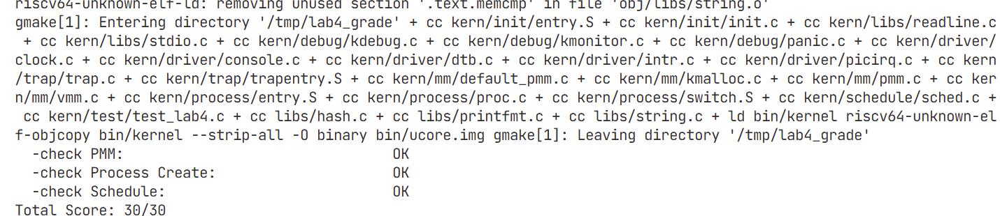
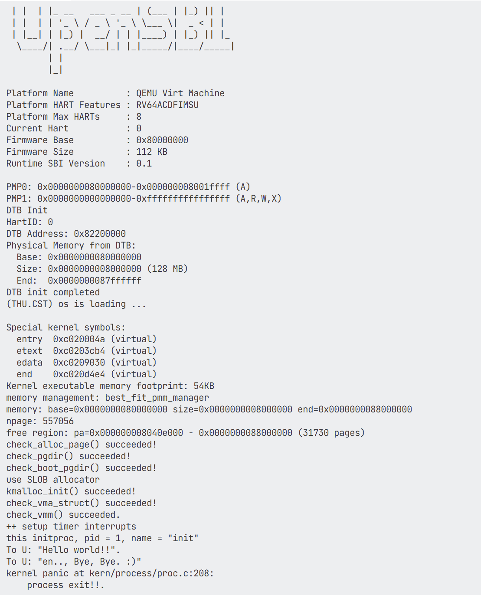

# 操作系统实验报告

## 实验基本信息

| 项目       | 内容                                 |
| -------- | ---------------------------------- |
| **实验名称** | Lab4 : \[进程管理]                  |
| **小组成员** | 2413330-张子馨、2410691-刘思岑、2411191-王可 |
| **完成日期** | 2026-11-15                         |

### 小组分工

| 成员          | 负责的模块                |
| ----------- | -------------------- |
| 2413330-张子馨 | 功能模块二 |
| 2410691-刘思岑 | 功能模块一 |
| 2411191-王可  | 功能模块三和扩展练习 |

---

## 一、实验目的


本实验的主要目的是：

1. 了解虚拟内存管理的基本结构，掌握虚拟内存的组织与管理方式
2. 了解内核线程创建/执行的管理过程
3. 了解内核线程的切换和基本调度过程

---

## 二、实验环境


| 成员 | AI 编程工具 | 底层模型 | 备注 |
|------|------------|---------|------|
| 2413330-张子馨| Cline（VS Code插件）|  DeepSeek-V4-Flash和DeepSeek-V4-pro| 勾选了计划和执行时使用不同的模型 |
| 2410691-刘思岑|Codex(VS Code插件)|ChatGPT-6-Sol| 无
| 2411191-王可| Codex（终端Agent）|GPT-6.1-Sol| 使用WSL环境运行Codex终端Agent|


---

## 三、实验整体逻辑分析

### 2.1 本章节的逻辑主线

- 核心主题：在已有物理内存管理和基础页表机制之上，搭建虚拟地址空间框架，并引入多执行流并发运行能力，使内核从单一执行流发展为支持多线程调度的内核。

- 解决的问题：让多个执行实体能够并发使用 CPU 运行。为此需要引入虚拟内存描述结构，管理每个执行实体的地址空间布局，并以预映射方式一次性完成全部页表映射，不涉及按需分配与页面置换；同时实现线程控制块、上下文切换和调度器，使内核能够调度多个线程轮流使用 CPU。内核线程仅在内核态运行并共享内核地址空间，用户进程在用户态与内核态之间切换并拥有独立的用户虚拟地址空间，两者在 ucore 中被统一处理，同属唯一的内核进程。

### 2.2 功能的逐步实现

本实验按照虚拟内存页操作、进程创建与初始化、进程调度三条主线推进，执行链可概括为 kern_init 到 pmm_init 到 vmm_init 到 proc_init 到 cpu_idle 到 schedule 到 proc_run 到 switch_to，前半段负责准备好地址空间，后半段负责让第一个可运行线程真正跑起来。

1. 首先实现**虚拟内存页操作**，即 page_insert 与 page_remove → 因为建立和撤销页表映射是所有地址空间操作的基础，只有页表项内容、物理页引用计数和 TLB 状态保持一致，后续线程的地址空间才有可靠支撑。
2. 接着完成**进程创建与初始化**，即 alloc_proc、proc_init、kernel_thread、do_fork、copy_thread 与 copy_mm → 因为有了可靠的页表操作，才能为线程准备控制块、内核栈和首次运行上下文，并使系统中出现 idleproc 与 initproc 两个关键线程。
3. 最后实现**进程调度**，即 cpu_idle、schedule、proc_run 与 switch_to → 因为线程对象创建完成后，还需要选出可运行线程、切换页表并保存恢复寄存器现场，才能让 initproc 真正从 idleproc 手中接管 CPU。

---

## 四、实验内容与实现


### 功能模块一：[模块名称]

**负责人：** [2410691-刘思岑]

#### 模块功能描述

**需要实现/修改的函数：**

```c
int page_insert(pde_t *pgdir, struct Page *page,
                uintptr_t la, uint32_t perm);
void page_remove(pde_t *pgdir, uintptr_t la);
```

**功能说明：**

本模块负责维护虚拟地址与物理页之间的映射关系。`page_insert` 通过 `get_pte` 获取页表项，建立新映射或更新已有映射，并设置页表权限；`page_remove` 撤销已有映射，对未映射的地址直接返回。

实现中分别处理了首次映射、替换为另一物理页、同一物理页重复映射三种情况，保证物理页引用计数与页表项一致。修改映射后调用 `tlb_invalidate`，防止 CPU 继续使用旧的地址翻译结果。该模块依赖物理页分配和多级页表机制，为后续内核线程运行提供基础映射能力。

#### 最终提示词

以下是经过迭代优化后，最终成功实现该功能的提示词：

````markdown
阅读当前工程的 `kern/mm/pmm.c`、`kern/mm/pmm.h` 及相关页表宏定义，只完成 Lab 4 功能模块一：在 `kern/mm/pmm.c` 的 `LAB4 function1 YOUR CODE` 位置实现以下函数：
```c
int page_insert(pde_t *pgdir, struct Page *page,
                uintptr_t la, uint32_t perm);
void page_remove(pde_t *pgdir, uintptr_t la);
```
将原位置标记改为 `//lab4-2410691`。不要实现其他 Lab 4 模块，也不要补写 Lab 2/3 的代码。
[SPECIFICATION]
1. `page_insert` 使用 `get_pte(pgdir, la, 1)` 获取目标页表项；获取失败时返回 `-E_NO_MEM`，且不能改变目标物理页的引用计数。
2. 新建映射时，增加目标物理页的引用计数，写入目标页号、`PTE_V` 和传入的权限。
3. 如果该地址已映射到同一物理页，只更新权限，不改变该页最终的引用计数，也不能错误释放该页。
4. 如果该地址已映射到另一物理页，应替换映射，减少旧页的引用计数；旧页引用计数降为 0 时释放它。
5. 修改页表项后，使该线性地址对应的 TLB 翻译失效。
6. `page_remove` 使用 `get_pte(pgdir, la, 0)`；页表项不存在或无有效映射时直接返回，不能为删除操作分配新的页表页。
7. 删除有效映射时，清空页表项、使 TLB 翻译失效，并正确减少及检查物理页引用计数。

[RELY]
优先使用框架已有的 `get_pte`、`pte2page`、`pte_create`、`page2ppn`、`page_ref_inc`、`page_ref_dec`、`free_page` 和 `tlb_invalidate`。核对这些函数在当前工程中的声明与返回值，不要凭其他版本 ucore 的接口猜测。

[CONSTRAINT]
只修改 `kern/mm/pmm.c` 中功能模块一的填空区域；保留其他模块和已有测试代码。代码风格尽量与当前文件一致，并给容易出错的“同一页重复映射”和“旧页释放”分支添加简短注释。

````

#### 实现迭代过程

本模块的实现经历了 [1] 次迭代，过程如下：

---

##### 第一次迭代

如果设计的prompt生成代码后出现问题：

**遇到的问题：**
- 问题1：原始 Lab 4 框架仍留有 Lab 2/3 的待补代码，且缺少 best_fit_pmm.h。因此暂时无法通过完整内核编译和运行结果判断模块一是否通过测试。

- 问题2：页表映射有两个容易遗漏的边界情况：同一物理页重复映射不能使引用计数变化；替换为另一物理页时要减少旧页的引用计数，并在引用计数为 0 时释放它。

**问题解决策略：**
- 针对问题1：在提示词的 [RELY] 中要求 AI 先核对当前框架的辅助函数签名，避免套用其他版本 ucore 的代码。
- 针对问题2：在 [SPECIFICATION] 中分别写明首次映射、同页更新、异页替换、无映射删除和内存不足的处理要求。
- 针对问题3：在 [CHECK] 中要求区分代码分析与实际测试结果，避免未经运行就报告“测试通过”。


**关键改进点总结：**
1. 明确同一物理页重复映射时只更新权限，不改变引用计数。
2. 明确替换和删除映射时，页表项、引用计数与 TLB 必须保持一致。
3. 明确删除映射时不得调用会创建页表页的 get_pte(..., 1)。
---


---
### 功能模块二：[进程创建及初始化功能]

**负责人：** [2413330-张子馨]

#### 模块功能描述

**需要实现/修改的函数：**

```c
static struct proc_struct *alloc_proc(void);
void proc_init(void);
int kernel_thread(int (*fn)(void *), void *arg, uint32_t clone_flags);
int do_fork(uint32_t clone_flags, uintptr_t stack, struct trapframe *tf);
static void copy_thread(struct proc_struct *proc, uintptr_t esp, struct trapframe *tf);
static int copy_mm(uint32_t clone_flags, struct proc_struct *proc);
```

**功能说明：**

本模块负责把系统从能运行内核代码推进到能创建并登记多个内核线程，是连接地址空间与调度的中间层。

- 在系统中的作用：alloc_proc 提供干净的进程控制块；proc_init 初始化进程链表与哈希表，把当前执行现场包装成 idleproc，并创建第一个内核线程 initproc；kernel_thread 把函数入口和参数整理成首次运行上下文；do_fork 把控制块、内核栈、PID、链表和状态组合成可运行实体；copy_thread 在新线程内核栈上安放 trapframe 和 context，形成 forkret 到 forkrets 到 __trapret 的首次运行链路；copy_mm 在本阶段承担地址空间处理接口的占位作用。
- 主要场景：idleproc 不经过 fork，直接复用 bootstack 和当前执行现场；initproc 由 do_fork 创建，PID 为 1，parent 为 idleproc。
- 与其他模块的交互：依赖模块一的页操作和物理页分配来建立内核栈，向模块三提供状态为 PROC_RUNNABLE 的线程对象，由 schedule、proc_run 和 switch_to 接管执行。

#### 最终提示词

以下是最终成功实现该功能的提示词：

````markdown

请在 kern/process/proc.c 的 LAB4 function2 标记处实现进程创建及初始化功能，包括 alloc_proc、proc_init、kernel_thread、do_fork、copy_thread、copy_mm。

功能要求：
- alloc_proc：用 kmalloc 分配 PCB 并初始化为安全空白状态，state 为 PROC_UNINIT，context 清零，tf 为 NULL，pgdir 为 boot_pgdir_pa。
- proc_init：初始化 proc_list 和 hash_list；idleproc 直接复用当前执行现场，PID 为 0，kstack 为 bootstack，state 为 PROC_RUNNABLE，current 指向 idleproc；随后用 kernel_thread 创建 init_main 线程作为 initproc，PID 为 1。
- kernel_thread：把 fn 和 arg 分别放入 tf.gpr.s0 和 tf.gpr.s1，status 设置 SSTATUS_SPP 和 SSTATUS_SPIE 并清除 SSTATUS_SIE，epc 指向 kernel_thread_entry，再调用 do_fork。
- do_fork：依次完成 alloc_proc、设置 parent 为 current、setup_kstack、copy_mm、copy_thread，在 local_intr_save 和 local_intr_restore 保护的临界区内分配 PID 并挂入 proc_list 和 hash_list，最后 wakeup_proc，失败时按相反顺序释放资源。
- copy_thread：在新线程内核栈顶安放 trapframe，context.ra 设为 forkret，context.sp 指向 trapframe，形成 forkret 到 forkrets 到 __trapret 的首次运行链路。
- copy_mm：本阶段不复制地址空间，直接返回 0。

注意事项：
- 保持线程生命周期状态与资源挂接顺序一致，避免资源泄漏和状态错误。
- idleproc 不经过 do_fork，其 tf、flags、context.ra 必须保持为 0。
- kernel_thread 与 copy_thread 必须和 entry.S 中 kernel_thread_entry 使用 s0 作为函数入口、s1 作为参数的约定一致。
- 测试要求 initproc 的 parent 为 idleproc，context.ra 和 context.sp 非零。

可借助接口：kmalloc、kfree、alloc_pages、free_pages、page2kva、kva2page、get_pid、find_proc、set_proc_name、wakeup_proc、list_init、list_add、local_intr_save、local_intr_restore、read_csr、bootstack、boot_pgdir_pa、CLONE_VM。

````

#### 实现迭代过程

本模块一次实现成功，未经历提示词迭代。

**最终结果：**

- 编译通过，未出现警告或错误。
- 实现满足 test_lab4_process_create 中的全部字段断言，包括 idleproc 的 PID、内核栈、父进程、状态以及 initproc 的 PID、parent 和首次运行上下文。
- 完整 qemu 运行测试需在功能模块一和功能模块三完成后统一进行。

---

### 功能模块三：[进程调度]

**负责人：** [2411191-王可]

#### 模块功能描述

**需要实现/修改的函数：**

```c
void cpu_idle(void);
```

**功能说明：**

作为空闲线程的执行主体，持续检查当前线程的调度标志。需要重新调度时调用`schedule()`，返回后继续循环，为其他线程提供运行机会。


**需要实现/修改的函数：**
```c
void schedule(void);
```

**功能说明：**

负责选择下一个运行线程。在关闭中断的临界区内清除调度标志，轮转查找可运行线程；找不到时选择空闲线程。更新运行次数，必要时调用`proc_run()`，恢复执行后还原中断状态。


**需要实现/修改的函数：**
```c
void proc_run(struct proc_struct *proc);
```

**功能说明：**

负责执行线程切换。目标不是当前线程时，保存并关闭中断，更新`current`，切换Sv39页表并刷新TLB，再调用`switch_to()`。旧线程恢复执行后，还原原先的中断状态。


**需要实现/修改的函数：**
```c
void switch_to(struct context *from, struct context *to);
```

**功能说明：**

负责底层寄存器上下文切换。使用RV64汇编保存旧线程、恢复目标线程的`ra`、`sp`和`s0`～`s11`，通过`ret`继续执行；配合进程创建模块，使新线程首次进入`forkret`。

#### 最终提示词

以下是经过迭代优化后，最终成功实现该功能的提示词：

````markdown

在code/目录中完成《riscv64-ucore-lab4-guide.pdf》中的“功能模块三：进程调度”。以ZIP中已经修改过的代码为基础，先阅读现有接口、函数和测试，再在标有`LAB4 function3 YOUR CODE`的位置补齐实现。

源码改动限于以下三个文件：
- kern/process/proc.c：实现cpu_idle和proc_run。
- kern/schedule/sched.c：实现schedule。
- kern/process/switch.S：实现RV64汇编函数switch_to，文件扩展名使用仓库里的大写.S。

沿用现有的进程创建、唤醒、页表管理和线程首次运行流程。模块一、模块二和Challenge不在本次实现范围内。保留现有函数签名、结构体布局和测试脚本。

[RELY]
- kern/process/proc.h：struct proc_struct、struct context、PROC_RUNNABLE、le2proc，以及current、idleproc、proc_list。调度使用state、list_link、need_resched、runs；实际切换使用pgdir和context。
- libs/list.h：list_entry_t和list_next()。proc_list是带哨兵的循环双向链表。普通线程通过list_link挂入链表，idleproc不在链表中。
- kern/sync/sync.h：local_intr_save(flag)、local_intr_restore(flag)，用于保存并恢复进入临界区前的中断状态，支持嵌套使用。
- libs/riscv.h 和 kern/mm/pmm.h：write_csr()、SATP_MODE_SV39、RISCV_PGSHIFT、boot_pgdir_pa、flush_tlb()。参考kern/mm/pmm.c的enable_paging()构造RV64 Sv39的satp。当前代码用boot_pgdir_pa初始化proc->pgdir，该字段保存页表根的物理地址。
- 现有proc_init()已创建idleproc和initproc。copy_thread()已把新线程的context.ra设置为forkret，把context.sp设置为该线程的trapframe地址。首次运行沿forkret → forkrets → __trapret → kernel_thread_entry进入线程函数。
- schedule()和 proc_run()已有声明，proc.c中已有switch_to()声明。沿用这些接口。

[GUARANTEE]
实现并交付以下四个函数，直接修改解压后的源码：
1. kern/process/proc.c中的void cpu_idle(void)
2. kern/schedule/sched.c中的void schedule(void)
3. kern/process/proc.c中的void proc_run(struct proc_struct *proc)
4. kern/process/switch.S 中可供C代码链接的全局符号switch_to，对应void switch_to(struct context *from, struct context *to)

完成后说明修改了哪些文件。在具备RISC-V交叉工具链和QEMU的环境中，从code/运行 `make qemu` 和 `make grade`，报告实际观察到的结果。若无法运行，说明缺少的工具或实际遇到的错误，并标明哪些测试尚未验证。

[SPECIFICATION]
1. cpu_idle(void)
   - 按现有noreturn声明实现无限空闲循环。
   - 循环检查current->need_resched。标志为真时调用schedule()，从schedule()返回后继续循环。调度标志由schedule()清除。

2. schedule(void)
   - 先保存并关闭本地中断，再清除current->need_resched。
   - current == idleproc时，从proc_list的第一个真实节点开始查找。否则，从current->list_link的下一个节点开始，经过表尾后回绕到表头，当前线程最多作为最后一个候选。
   - 通过le2proc(node, list_link)取得候选线程，按遍历顺序选择第一个PROC_RUNNABLE。跳过链表哨兵，最多遍历一圈。链表为空或没有可运行线程时，选idleproc。
   - 对选中的线程执行一次runs++，即使选中的是current或idleproc。只有选中的线程与current不同，才调用proc_run(next)。
   - 查找、计数和发起切换都在关中断的临界区内。该次schedule()调用继续执行时，恢复这次调用保存的中断状态。选中当前线程、空链表等路径也要正确恢复。

3. proc_run(struct proc_struct *proc)
   - 如果proc == current，直接返回。
   - 对实际切换，先保存并关闭本地中断，再保存旧的current指针并将current更新为proc。
   - 用目标进程的页表根物理地址构造`((uintptr_t)SATP_MODE_SV39 << 60) | (proc->pgdir >> RISCV_PGSHIFT)`，通过write_csr(satp, ...)写入，然后调用flush_tlb()。禁止使用沿用Sv32格式的lsatp()。
   - 页表切换完成后，调用switch_to(&prev->context, &proc->context)。旧线程之后被调度回来、从这次switch_to调用继续执行时，恢复它在本次proc_run()中保存的中断状态。

4. switch_to(struct context *from, struct context *to)
   - 在.text段导出全局符号switch_to。按RV64调用约定，a0是from，a1是to。
   - 用sd把旧线程的ra、sp、s0至s11保存到from。按struct context的实际布局，ra的字节偏移是0，sp是8，s0至s11是16、24、…、104。
   - 用ld从to的对应偏移恢复同一组寄存器，再用ret跳转到恢复后的ra。首次运行的新线程由此进入forkret，已经运行过的线程从之前的切换调用处继续执行。
   - 此函数只保存和恢复寄存器上下文。中断状态、页表和调度选择由上层处理。

验收时，用`make qemu`确认initproc打印`this initproc, pid = 1, name = "init"` 和 `To U: "Hello world!!".`；用`make grade`检查`[Test Schedule] PASS`。评分脚本会检查两个测试线程都获得过执行机会。当前源码的do_exit()是会触发`process exit!!`的占位实现，如果问候信息打印后出现该提示，请如实记录，无需为此改写do_exit()。c:\Users\27566\Desktop\riscv64-ucore-lab4-guide.pdf


````

#### 实现迭代过程

本模块一次实现成功，未经历提示词迭代。

**最终结果：**

经过 [0] 次迭代，该模块最终：
- ✅ 编译通过
- ✅ 所有相关测试通过
- ✅ 功能符合预期


---

### Challenge：[扩展练习 Challenge]

**负责人：** [2411191-王可]

1. 说明语句 local_intr_save(intr_flag); ... local_intr_restore(intr_flag); 是如何实现开关中断的。

答： `local_intr_save(intr_flag)`读取`sstatus`寄存器的SIE位，记录当前中断是否开启；若已开启，则关闭本地中断，保护中间代码的执行。`local_intr_restore(intr_flag)`根据保存的状态决定是否重新开启中断：原先开启才恢复开启，原先关闭则保持关闭，因此支持嵌套使用。

2. 深入理解不同分页模式的工作原理（思考题）。
get_pte() 函数位于 kern/mm/pmm.c，用于在页表中查找或创建页表项，从而实现对
指定线性地址对应的物理页的访问和映射操作。这在操作系统的分页机制下，是虚拟内存
与物理内存建立映射关系的关键基础。
get_pte() 函数中有两段形式类似的代码，结合 sv32、sv39、sv48 的异同，
解释这两段代码为什么如此相像。
目前 get_pte() 函数将页表项查找和页表页分配合并在一个函数里，你认为这种
写法好吗？有没有必要把两个功能拆开？

答： `get_pte()`中两段代码分别处理Sv39三级页表中的两个上层目录，执行的都是“检查有效位，必要时分配并清零下一级页表，再建立指向关系”，因此结构相似。Sv32、Sv39、Sv48均采用多级页表，分别使用两级、三级、四级；Sv32每级索引为10位、页表项为4字节，Sv39和Sv48每级索引为9位、页表项为8字节，但逐级查表的原理相同。
将查找和分配合并，通过`create`参数控制，能复用遍历逻辑，适合本实验；缺点是调用时可能修改页表并发生内存分配失败。若系统规模扩大，可以提供“只查找”和“查找并创建”两个接口，内部共享遍历代码，使职责和副作用更清晰，但本实验没有必要强制拆分。

---

## 五、测试与验证


**测试截图：**





---

## 六、实验总结与收获

### 对操作系统的理解

1. 通过本次实验，我认识到操作系统的核心是管理硬件资源，并为程序提供统一的运行环境。内存管理通过页表建立虚拟地址与物理地址的映射；进程管理通过进程控制块记录程序的运行状态；调度机制则选择可运行线程，通过保存和恢复上下文实现CPU执行权的转移。多个程序能够交替运行，依赖这些机制的共同配合。
2. 操作系统还必须保证状态变化的一致性。例如，切换线程时，当前线程指针、页表和寄存器上下文需要协调更新，因此要通过关闭中断保护关键操作。这让我理解到，操作系统不仅要完成资源分配，还要在效率、公平性和正确性之间进行权衡。

### AI 协作开发的经验

在与AI协作的过程中，我们体会到，清晰的需求和约束能减少实现偏差：提前说明函数接口、修改范围、数据结构和预期行为，有助于生成符合项目要求的代码。AI能辅助实现和分析，但理解原理、核对代码与验证结果仍需要我们自己完成。

---

